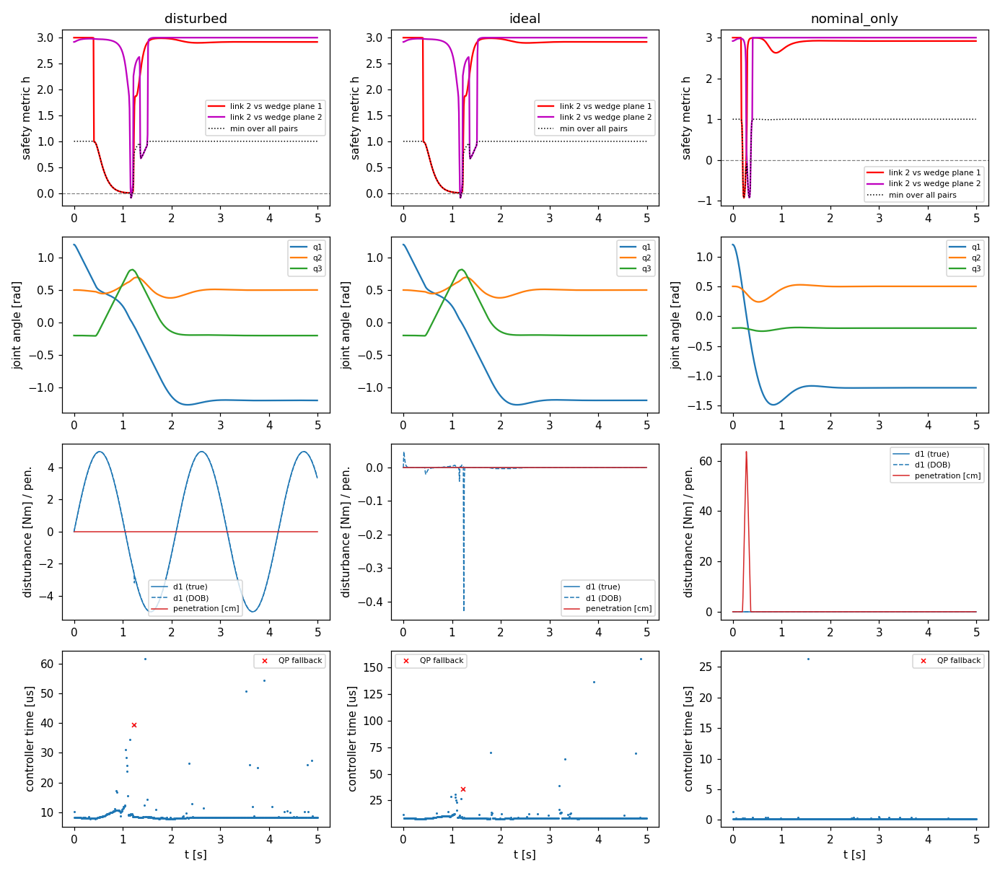
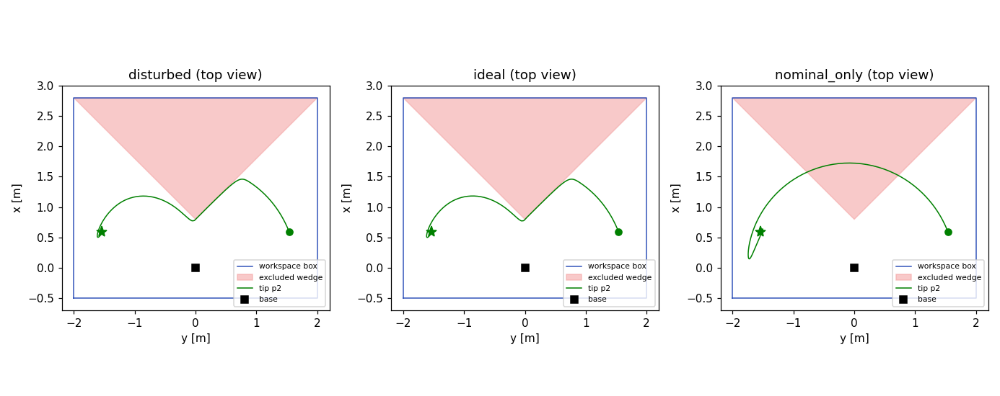

# Geometric whole-body containment control on a Yolo UNO (ESP32-S3)

Embedded implementation and computational benchmark of the safety-critical controller from
*"Safe Manipulation in Non-Convex Workspaces Through Geometric Containment Metrics for General
n-DOF Serial Manipulators"* (ICARCV 2026): a disturbance observer (DOB), a PD-like nominal law,
a geometric safety metric turned into high-order CBF constraints, a QP safety filter and a
dissipative braking fallback.

The firmware runs the full controller on the Yolo UNO at 1 kHz in a **processor-in-the-loop**
setup: the 3-DOF manipulator of Sec. IV is simulated on the same chip (RK4) to close the loop,
and only the controller is timed with the CPU cycle counter. The same C++ core also builds on a
PC for functional checks.

## What runs each control period

| Stage (timed separately) | Paper | Code |
|---|---|---|
| `dyn` – M, C, G, M⁻¹ | Eq. (1), Sec. IV | `robot.cpp` |
| `dob_nom` – DOB output + nominal torque | Eqs. (2)–(3), (6) | `controller.cpp` |
| `safety` – h_ik for every (link, face) pair, Jacobian, HOCBF rows, velocity-CBF rows | Eqs. (7)–(18) | `safety.h`, `controller.cpp` |
| `qp` – safety filter, braking fallback, DOB state update | Eqs. (19)–(20), (2) | `qp.cpp`, `controller.cpp` |

For the default scene that is N = 2 links × K = 11 convex faces = 22 HOCBF rows, plus 6
velocity-CBF rows and 6 torque bounds: a QP with 3 variables and 34 constraints every millisecond.

`h_ik`, its Jacobian `J_h`, `ḣ = J_h q̇` and `J̇_h q̇` come out of **one** evaluation per pair
using a small forward-mode automatic-differentiation type (`jet.h`), so no finite differences and
no hand-derived Jacobians are needed. The QP is solved with Hildreth's dual coordinate-ascent
method: no factorisations, fixed memory, warm-started from the previous step, and an iteration cap
that maps directly to the paper's "QP fails to return within the sampling period → fallback".

## Repository layout

```
lib/gc_core/src/   portable controller core (no Arduino dependency)
  gc_config.h        scalar type (float/double), sizes
  jet.h, vec3.h      forward-mode AD number, 3-vectors
  robot.*            3-DOF dynamics and forward kinematics
  safety.*           safety metric h_ik, workspace faces, the wedge scene
  qp.*               Hildreth QP solver
  controller.*       DOB + nominal + HOCBF/velocity CBF + QP + fallback
  scenario.*         closed-loop run, plant (RK4), ground-truth check, timing statistics
src/main.cpp       Yolo UNO firmware (serial output, cycle-counter timing)
host/              PC build of the same core (functional reference + timing baseline)
tools/             capture_serial.py (save board output), plot_results.py (figures)
```

## Build and flash (PlatformIO)

```bash
pio run -e yolo_uno_f32 -t upload     # single precision (hardware FPU)
pio run -e yolo_uno_f64 -t upload     # double precision (software-emulated on ESP32-S3)
```

The project uses the generic `esp32-s3-devkitc-1` board definition with a 4 MB flash layout.
If the serial monitor stays silent, change `-DARDUINO_USB_CDC_ON_BOOT=1` to `0` in
`platformio.ini`.

## Collect results from the board

```bash
pip install pyserial numpy matplotlib
python tools/capture_serial.py --port COM5            # or /dev/ttyACM0
python tools/plot_results.py results
```

This writes `results/log_<scenario>.csv`, `results/summary.csv`, `results/summary.md`,
`results/results.png` and `results/topview.png`. Send `b` instead (`--cmd b`) for
timing-only runs without trajectory logging (5 repeats per scenario).

Each `#SUMMARY` line reports per-stage average and maximum time, p50/p99 of the total, CPU
utilisation of the 1 ms budget, QP iterations, fallback count, the worst safety metric, the exact
penetration depth into the excluded region, and the final joint error. Free stack and heap are
printed at the end of each run.

Scenarios: `nominal_only` (filter off, shows the collision), `ideal` (d = 0) and `disturbed`
(d = [5 sin 3t, 10 cos t, −10 sin 1.5t]ᵀ N·m, as in the paper).

## Host build (PC)

```bash
make -C host && ./host/gc_host && python tools/plot_results.py host
```

Reference behaviour from the host build (float):

| scenario | max penetration | fallbacks | final error | QP iterations (avg) |
|---|---|---|---|---|
| nominal_only | 651 mm | – | 0.000 rad | – |
| ideal | 0.0 mm | 2 | 0.000 rad | 6.1 |
| disturbed | 0.0 mm | 2 | 0.001 rad | 6.2 |




The tip slides along wedge plane 1, the elbow folds (q3 rises to about 0.8 rad) to pass the apex,
and the arm reaches the goal on the other side; the disturbed run is visually identical, as in
Fig. 4–5. Penetration is measured by an exact point-in-P test on 21 samples per link,
independent of the smoothed metric.

## Model, scene and parameters

**Robot model.** Full Table I parameters with configuration-dependent M(q), C(q, q̇) and G(q).
Angles follow the MATLAB simulation: q1 = base pan, q2 = shoulder elevation measured from the
horizontal, q3 = elbow angle relative to link 1. With this convention the horizontal reaches are
cosines and the gravity terms are

  G₂ = (m₁r₁ + m₂L₁) g cos q₂ + m₂r₂ g cos(q₂+q₃),  G₃ = m₂r₂ g cos(q₂+q₃),

and M₁₁ = I_b + m₁(r₁ cos q₂)² + m₂(L₁ cos q₂ + r₂ cos(q₂+q₃))². A passive-arm energy check
(u = 0, no friction) conserves energy to 2·10⁻¹⁴ relative error, confirming that M, C and G are
mutually consistent.

**Scene.** Same as the MATLAB animation: box x ∈ [−0.5, 2.8], y ∈ [−2, 2], z ∈ [−1, 2] m with
the wedge {x ≥ 0.8 + |y|} removed. Floor and ceiling are split into convex pieces
(Assumption 2), giving 11 faces. Start q = (1.2, 0.5, −0.2), goal q = (−1.2, 0.5, −0.2) rad.

**Parameters.** Taken from the MATLAB code (Kp = 50, Kd = 10, γ1 = γ2 = 10, α = 10,
K_brake = 150, |q̇| ≤ 1.5 rad/s, −d̂ fed forward in u_nom) with two changes the full model needs:

1. **γ_vel = 50 instead of 15.** The velocity CBF q̈_i ≤ γ_vel (q̇_max − q̇_i) caps deceleration
   below what the HOCBF needs near the wedge. With 15 the QP was infeasible in 3,473 of 5,000
   steps; with 50 it fails twice.
2. **DOB gain 200 instead of 40.** Faster disturbance tracking keeps the disturbed run free of
   penetration (21 mm with gain 40).

## Implementation notes

1. **Metric constants.** c = 1 (gives the steady value 3 seen in Fig. 5) and c2_ik = J_k − 1.5.
   With c2 ≥ J_k − 1, intersection points lying exactly on a face edge are not detected.
2. **Constraint activation (`h_activate = 1.2`).** HOCBF rows are built only for pairs with
   h_ik < 1.2. When a link does not straddle a plane, h1 ≈ +1 and the pair is safe whatever h2
   does, but h2 can swing sharply as the *extrapolated* line–plane intersection crosses a face
   edge far from the link. Constraining those swings made the QP fail in most steps (3,270
   fallbacks with all pairs). Set `h_activate = 1e9` for the all-pairs formulation.
3. **Nominal feedforward.** `nominal_dob_ff = true` matches the MATLAB code. Eq. (6) in the paper
   omits −d̂; without it a disturbance leaves a steady-state error of about P⁻¹d.
4. **DOB.** Uses K_C = K − Cᵀ as in Eq. (2). The MATLAB demo's `C*dq` term is only equivalent
   because C = 0 there.
5. **Fallback.** Triggered when Hildreth does not converge within `qp_max_iter` sweeps or the
   result is infeasible. The braking torque of Eq. (20) is saturated by the actuator model.

## License

Add a license of your choice before publishing.
